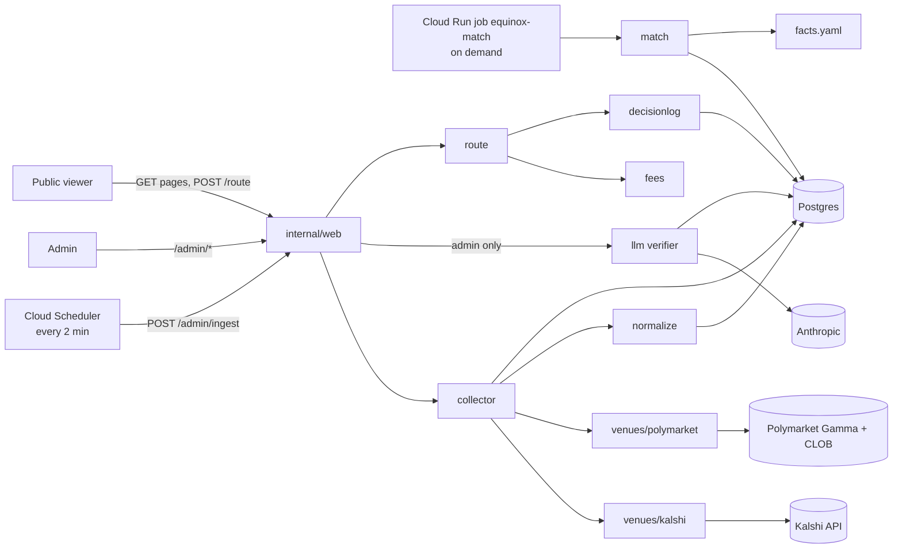

<!-- OWNER: shared. Operator may update to match reality; every change is logged in docs/decisions.md. -->
# Architecture

## Tech stack

| Layer | Choice | Version | Why (decision) |
|---|---|---|---|
| Language | Go | **1.27.2**: `go 1.27.0` + `toolchain go1.27.2` in go.mod; CI image `golang:1.27.2`; Dockerfile `golang:1.27.2-bookworm` (1.27.1 at M1-01, bumped for stdlib advisories) | PEAK6's internal stack (D-001, D-050) |
| HTTP / UI | `net/http`, `html/template`, htmx, Pico.css (classless) | htmx 2.x, Pico 2.x, pinned with SRI in M1-08 | No JS build; UI polish is not graded but clarity matters (D-004, D-031) |
| Database | PostgreSQL | 16 (Cloud SQL `POSTGRES_16`, `postgres:16` locally) | Persistent history across fetch rounds; relational joins (D-016). Raw venue responses are stored gzipped in a `bytea` column (`raw_responses.body_gz`), not JSONB; parsed fields such as terms, books and diffs use `jsonb` |
| DB driver / migrations | `jackc/pgx/v5`, `pressly/goose/v3` | latest v5 / v3 | Boring, standard |
| Money / prices | `shopspring/decimal` | latest | No floats for prices or fees |
| Config | env vars + YAML (`config/universe/<venue>.yaml`, `config/facts.yaml`) via `gopkg.in/yaml.v3` | latest | Facts and venue universe are reviewable data (D-021) |
| LLM | Anthropic Messages API called with stdlib `net/http` (`internal/llm/anthropic.go`), not `anthropic-sdk-go`; model `claude-haiku-4-5-20251001` | n/a (no SDK dependency) | Cheapest tier under the budget (D-003, D-022, D-046); a short stdlib client instead of 10+ SDK dependencies (D-075) |
| Logging | `log/slog` JSON | stdlib | Cloud Logging parses JSON natively (D-036) |
| Testing | `go test`, `pgregory.net/rapid` (property tests), Go native fuzzing, Postgres from docker compose locally and a CI service | latest | Property tests for parsers and financial math (D-047) |
| Lint / security | `golangci-lint` v2, `govulncheck`, `gitleaks` | latest | CI gates (D-047) |
| Hosting | Cloud Run (us-central1), Cloud SQL, Secret Manager, Cloud Scheduler, Artifact Registry | n/a | GCP project `peak6-equinox-510816` (D-002, D-033) |
| CI | GitLab CI on shared runners | n/a | Repo is on Gauntlet GitLab (D-037) |

## Components and responsibilities

| Package | Responsibility | May import |
|---|---|---|
| `cmd/equinox` | CLI entry point: `migrate`, `ingest`, `seed`, `match`, `pin`, `route`, `eval`, `backtest`, `golden`, `serve`, `fixture-server`, `record-fixtures`, `version` | everything |
| `internal/canonical` | Venue-independent types (`Instrument`, `Terms`, `Quote`, `Level`, `Relationship`, `Order`, `Decision`, `FeeSchedule`) and their validation | stdlib, decimal |
| `internal/venues` | `Adapter` interface and registry | canonical |
| `internal/venues/kalshi`, `internal/venues/polymarket` | Venue HTTP clients and mapping into canonical types. **The only place venue schemas exist.** | canonical, venues |
| `internal/collector` | One fetch round: fetch all adapters concurrently, store raw + canonical, record per-venue status | venues, store, normalize |
| `internal/normalize` | Extract `Terms` from title and rules text, per category (`crypto`, `fed`, `politics`). Unparseable means `unknown`. | canonical |
| `internal/match` | Blocking, hard vetoes, soft checks, classification, contract diff, basis risk; uses facts | canonical, facts |
| `internal/facts` | Load and validate `config/facts.yaml` | canonical |
| `internal/llm` | `Verifier` interface, Anthropic client, guard (schema check, downgrade-only), cache, budget cap | canonical, store |
| `internal/fees` | Compute fees from a `FeeSchedule` (formula as data) | canonical, decimal |
| `internal/route` | Eligibility, book walk, cost terms, sweep, complement routes, explanation. **Venue-agnostic.** | canonical, fees, decimal, stdlib **only** (enforced by `internal/route/imports_test.go`) |
| `internal/eval` | Golden-set metrics and settlement back-test | canonical, match, store |
| `internal/store` | Postgres access (parameterised SQL only), migrations in `migrations/` | canonical, pgx |
| `internal/web` | Handlers, templates, middleware (CSP, rate limit, basic auth on `/admin`, origin check) | everything except venues |
| `internal/decisionlog` | Write and read decision-log entries | store |

## Data flow



Each step of the flow:

1. A **fetch round** starts on a Scheduler call (every 2 minutes in production, D-130), an admin call, or `equinox ingest`.
2. The collector calls both adapters concurrently. Each adapter returns raw responses plus canonical `Instrument`s and `Quote`s stamped with `fetched_at` (and `venue_ts` when present).
3. Raw bodies are gzipped into `raw_responses`. Instruments are upserted, and quotes are inserted per round.
4. **Matching runs on demand, not after every ingest** (D-065, Q-5). `equinox match` (locally, or as the Cloud Run job `equinox-match` in production) runs over one round's instruments: normalise, block, veto, classify, diff, then score basis risk. The resulting `relationships` are stored for that round, and each verdict goes to the decision log. The operator then pins the matched round with `equinox pin` (or `equinox match --pin-min-routable N`), so `/` stays on a matched round while new fetch rounds keep arriving. The rules behind each step are written up in [equivalence.md](equivalence.md).
5. The admin may run the LLM verifier. It can only downgrade a relationship, and it records its verdict.
6. `POST /route` takes an `Order` for a target instrument and finds its `equivalent`, `equivalent_given_facts` and `complement` partners in the pinned (or current) round. The router is pure: inputs in, `Decision` out. The decision is logged.

**Which data a page uses** (D-117, since !128). Pairs, relationship types and diffs come from the **pinned round** if one is set, and otherwise from the latest successful round. Prices, quote ages and routing use the **newest collected quote** for each instrument (`internal/web/live_quotes.go`), and quote age is measured against the newest round's snapshot time, so a pinned round still shows current prices. Both come from Postgres only; serving a page or a route makes no venue call (NFR-04). The site banner says which round the pairs come from.

## Interfaces and contracts

```go
// internal/venues
type Adapter interface {
    Venue() canonical.Venue // "kalshi" | "polymarket"
    // FetchInstruments returns open instruments for the configured universe plus the raw bodies it read.
    FetchInstruments(ctx context.Context, u Universe) ([]canonical.Instrument, []RawResponse, error)
    // FetchQuotes returns one Quote per instrument; YesAsks/YesBids are normalised to YES-side probabilities.
    FetchQuotes(ctx context.Context, ins []canonical.Instrument) ([]canonical.Quote, []RawResponse, error)
    // FetchSettled returns settled instruments with their outcome, for the back-test.
    FetchSettled(ctx context.Context, u Universe, since time.Time) ([]canonical.Settled, []RawResponse, error)
}

// internal/normalize
func Extract(in canonical.Instrument) canonical.Terms

// internal/match
func Compare(a, b canonical.Instrument, f facts.Set) canonical.Relationship

// internal/llm
type Verifier interface {
    Verify(ctx context.Context, a, b canonical.Instrument, r canonical.Relationship) (canonical.LLMVerdict, error)
}
// Apply enforces downgrade-only: the result's Type is never "stronger" than r.Type.
func Apply(r canonical.Relationship, v canonical.LLMVerdict) canonical.Relationship

// internal/route
func Route(o canonical.Order, target canonical.Candidate, partners []canonical.Candidate, cfg Config, now time.Time) canonical.Decision
```

Contracts every implementation must honour:

- **Prices** are `decimal.Decimal` in [0,1] per $1 payout. **Sizes** are contracts (decimal). Both are validated in `canonical`.
- **Times** are `time.Time` in UTC. `Terms.DeadlineTZ` keeps the venue's stated timezone.
- **Relationship strength order** (for downgrade-only): `equivalent` > `equivalent_given_facts` > `complement` = `implies` > `related` > `unrelated`. For downgrade purposes, `complement` and `implies` may only move to `related` or `unrelated`.
- **Every** `Relationship` and `Decision` carries a non-empty `Explanation` and the round ID.
- Adapters never return a partial `Instrument` silently. Missing fields go in `Instrument.Quality` flags.

## Data model

Postgres. Migrations live in `migrations/NNNN_name.sql`, run with goose.

| Table | Key columns |
|---|---|
| `fetch_rounds` | `id bigserial pk`, `started_at`, `finished_at`, `status` (`running` until finished, then `ok`/`partial`/`failed`), `venue_status jsonb`, `pinned bool` (at most one true) |
| `raw_responses` | `id`, `round_id fk`, `venue`, `endpoint`, `http_status`, `body_gz bytea`, `fetched_at` |
| `instruments` | `id text pk` (`kalshi:<ticker>`, `polymarket:<token_id>`), `venue`, `venue_market_id`, `venue_event_id`, `category`, `title`, `rules_text`, `rules_summary text`, `clarifications text`, `clarifications_updated_at timestamptz`, `terms jsonb`, `polarity`, `close_time`, `expiration_time`, `status`, `fee_schedule jsonb`, `quality jsonb`, `first_seen_round`, `last_seen_round` |
| `quotes` | `pk(round_id, instrument_id)`, `yes_bids jsonb`, `yes_asks jsonb`, `best_bid`, `best_ask`, `mid numeric`, `fetched_at`, `venue_ts`, `quality jsonb`, index `quotes_instrument_fetched` on `(instrument_id, fetched_at)` (D-116) |
| `relationships` | `id`, `round_id`, `a_id`, `b_id`, `type`, `confidence numeric`, `method` (`rules`/`rules+llm`), `diff jsonb`, `vetoes jsonb`, `facts_used jsonb`, `basis_risk jsonb`, `evidence jsonb`, `explanation text`, unique `(round_id,a_id,b_id)` |
| `llm_verdicts` | `cache_key text pk` (sha256), `model`, `prompt_version`, `verdict jsonb`, `created_at` |
| `llm_usage` | `day date pk`, `calls`, `input_tokens`, `output_tokens` |
| `llm_verify_last_run` | `id boolean pk default true check (id = true)` (singleton), `verified integer`, `downgraded integer`, `cache_hits integer`, `ran_at timestamptz` (UI-08 follow-up, issue #40) |
| `match_runs` | `id bigserial pk`, `round_id fk`, `started_at`, `finished_at`, `duration_ms`, `pairs_compared`, `relationships_stored`, `outcome` (`ok`/`failed`), retention capped at 500 rows (UI-26 phase 1, issue #58) |
| `routing_decisions` | `id`, `round_id`, `order jsonb`, `decision jsonb` (includes `inputs` and `target_type` since UI-25, D-099), `created_at` |
| `decision_log` | `id`, `kind` (`relationship`/`routing`/`llm`/`ingest`), `ref`, `summary`, `payload jsonb`, `created_at` |

Golden labels are files in the repo (`testdata/golden/labels.yaml`), not DB rows, so they are reviewable.

**Rule layers** (D-103, UI-21): `instruments.rules_text` stays combined for matching compatibility. New columns `rules_summary`, `clarifications`, `clarifications_updated_at` store separate layers for display. Kalshi: `rules_summary` = `rules_primary` (per-strike summary), `clarifications` = `rules_secondary` (Additional Details), timestamp not published. Polymarket: both empty (no separate layers beyond main rules). Not fed to matcher or LLM in UI-21.

## External services

| Service | Access | On failure |
|---|---|---|
| Kalshi public API `https://api.elections.kalshi.com/trade-api/v2` | No auth. `GET /events?series_ticker=…&status=open&with_nested_markets=true&limit=200` (cursor-paginated), `GET /markets/{ticker}/orderbook`, `GET /markets?series_ticker=…&status=settled&min_close_ts=<unix>&limit=200` (cursor-paginated). Exclude markets with a non-empty `mve_collection_ticker`. Verified 2026-10-06 (M1-04, D-056): open markets have `status` `active` and settled ones `finalized`, with `result` `yes`/`no` and `settlement_ts`; prices are dollar strings (`"0.9900"`) and sizes `_fp` strings (`"7246.15"`); the book is `{"orderbook_fp":{"yes_dollars":[[price,size],…],"no_dollars":[…]}}`, bids only, each side sorted lowest price first. Bursts get 429 with no `Retry-After`. | 10 s timeout, 2 retries with exponential backoff (1 s, 2 s) on 429/5xx, requests paced ≥ 100 ms apart, 10 MB body cap. The venue is marked failed in the round, which still completes with the other venue. |
| Polymarket Gamma `https://gamma-api.polymarket.com` | No auth. `GET /events?tag_slug=…&active=true&closed=false&exclude_tag_id=102127&limit=50&offset=…` (offset-paginated, at most 40 pages per tag). Settled: `GET /events?tag_slug=…&closed=true&order=endDate&ascending=false&exclude_tag_id=102127&limit=50&offset=…`, newest end date first, stopping at the first page that reaches events ending before `since`. `outcomes`, `outcomePrices` and `clobTokenIds` are JSON-encoded strings. Verified 2026-10-06 (M1-05, D-057): open events can contain closed markets; tag `102127` (`up-or-down`) is 5-minute to daily `Up`/`Down` markets (not YES/NO), most of the `crypto` tag's ~2,100 events; each market has `feesEnabled` and `feeSchedule` (`rate`, `exponent`); `endDate` is RFC 3339, `closedTime` is `2006-01-02 15:04:05+00`. Offsets past ~500 on large closed listings return HTTP 500. | Same as above, with 8 books fetched at a time |
| Polymarket CLOB `https://clob.polymarket.com` | No auth. `GET /book?token_id=…` returns `{asset_id, timestamp (unix ms string), bids, asks}` with `price`/`size` strings; bids are sorted lowest first and asks highest first (worst first), so the adapter sorts best first. Resting orders at 0.001 / 0.999 are common and are kept. A token with no book gives HTTP 404. | Same as above. Books missing → quote flagged `no_book`, and the instrument is ineligible for routing. |
| Anthropic Messages API | `ANTHROPIC_API_KEY` from Secret Manager. Admin-triggered only. | The verdict is recorded as `llm_error` and the rules verdict stands. The cap is reached when `llm_usage.calls ≥ LLM_DAILY_CALL_CAP`. |
| Cloud SQL | Cloud Run built-in Cloud SQL connection (unix socket `/cloudsql/<instance>`), `DATABASE_URL` secret | `GET /health` is a liveness check only and does not query the database (`/healthz` is reserved by Cloud Run, D-052); pages that read the database fail until it is back |
| Cloud Scheduler | `equinox-collect`: HTTP target `POST /admin/ingest` with a basic-auth header (the admin password from Secret Manager), every 2 minutes (`*/2 * * * *`, D-130; `scripts/gcp-bootstrap.sh` still creates it at `*/5`). `equinox-rematch-hourly`: runs the `equinox-match` job at minute 17 with `--latest --pin-min-routable 10`, created **paused** (D-117) | A missed round shows in the collector success rate (NFR-05) |

Venue endpoint details and series and tag names are **verified in M1-04 (Kalshi) and M1-05 (Polymarket)**. Any correction is a Tier 1 update to this table and to `config/universe/<venue>.yaml`.

## Target directory structure

```
cmd/equinox/            main.go (registry), one file per subcommand
internal/config/        env loading
internal/canonical/     types + validation
internal/venues/        adapter.go, registry.go, universe.go, fixtureserver/
internal/venues/kalshi/ client.go, map.go, *_test.go
internal/venues/polymarket/
internal/collector/
internal/normalize/     crypto.go, fed.go, politics.go
internal/match/         block.go, veto.go, classify.go, diff.go, basis.go
internal/facts/
internal/llm/           verifier.go, anthropic.go, guard.go, cache.go, budget.go
internal/fees/
internal/route/         route.go, eligibility.go, sweep.go, explain.go, imports_test.go
internal/eval/
internal/store/
internal/web/           server.go, middleware.go, handlers_*.go, templates/, static/
internal/decisionlog/
migrations/
config/                 universe/{kalshi,polymarket}.yaml, facts.yaml
testdata/fixtures/      recorded venue responses (kalshi/, polymarket/)
testdata/golden/        candidates.yaml, labels.yaml
tests/e2e/              smoke_test.go
tests/security/         ab01_*_test.go …
scripts/                gcp-bootstrap.sh, check-coverage.sh, guard-human-files.sh, check-log-fresh.sh
docs/
Dockerfile  docker-compose.yml  Makefile  .gitlab-ci.yml  .golangci.yml  .gitleaks.toml  .env.example
```
